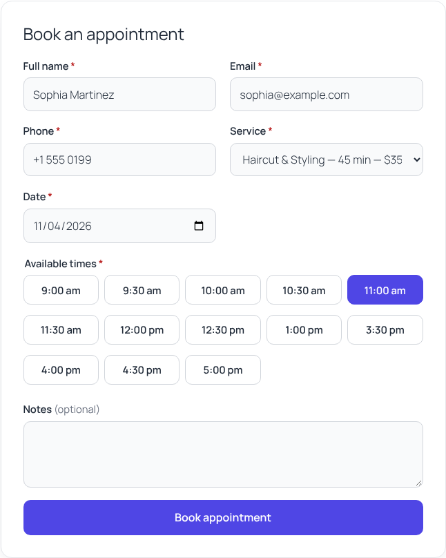
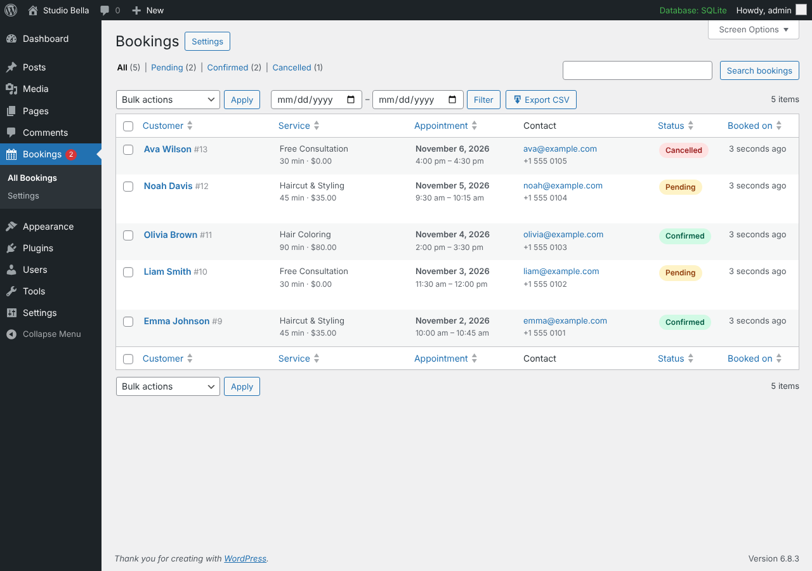
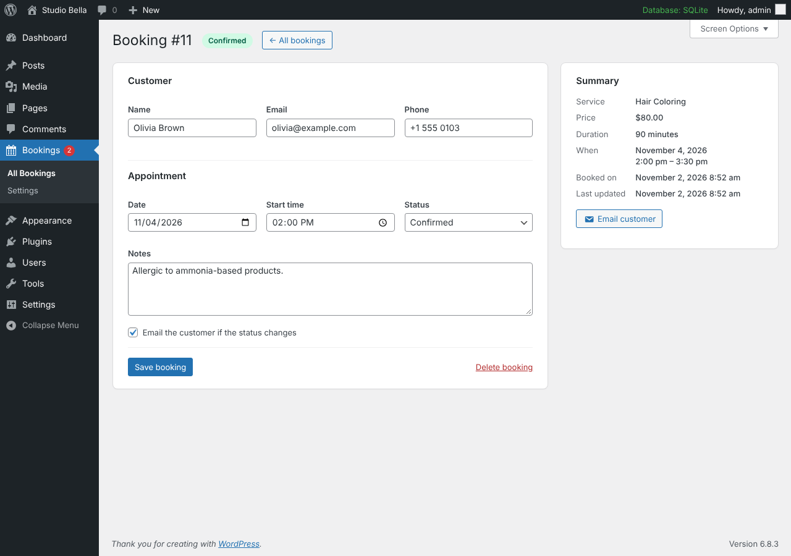
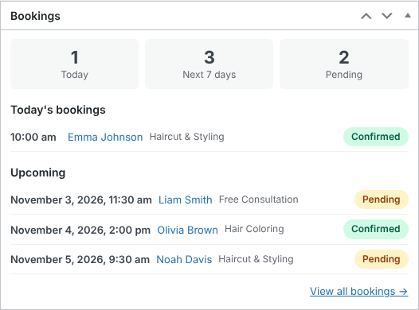
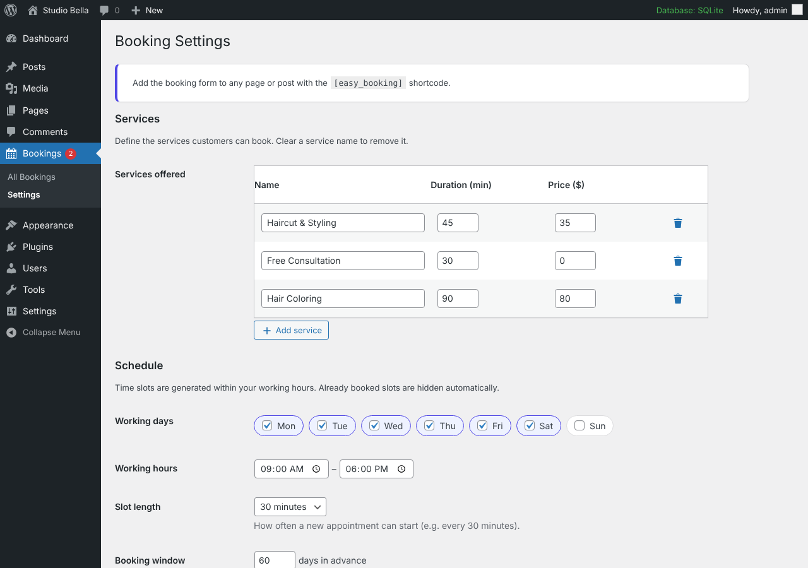

# Easy Appointment Booking

A lightweight WordPress plugin for taking appointment bookings. Customers book through a fast AJAX form, and you manage everything from a clean admin dashboard. The plugin is built to WordPress.org standards: secure, translation-ready and dependency-free.

[](https://playground.wordpress.net/?blueprint-url=https://raw.githubusercontent.com/Sharvan10/wp-easy-booking/main/blueprint.json)


> **Live Demo:** the button above opens a disposable WordPress site in your browser, using [`blueprint.json`](blueprint.json). The site has the plugin installed, a booking page, 3 sample services and 5 sample bookings. You are logged in as admin, so you can also look around the dashboard. Nothing to install.

---

## Features

**Frontend booking form**
- Add it anywhere with the `[easy_booking]` shortcode.
- Fields: name, email, phone, service (dropdown), date picker, time slot and notes.
- Shows only available slots. Booked times are hidden automatically.
- Submits with AJAX, shows inline field errors and a success message, and never reloads the page.
- Responsive and accessible: labels, `aria-live` messages and keyboard-friendly slot picker.

**Admin dashboard**
- **Bookings list** (`WP_List_Table`): search, status views, date range filter, sortable columns, bulk confirm/cancel/delete, pagination and a "per page" screen option.
- **Single booking screen:** view and edit customer details, date, time and status (Pending, Confirmed or Cancelled), with an option to notify the customer.
- **Settings page** (Settings API): services (name, duration, price), working days, working hours, slot length, booking window, currency, notification email and email templates.
- **Dashboard widget:** today's bookings, the next 7 days and the number of pending bookings.
- **CSV export** that follows the current list filters.
- A pending-count bubble on the admin menu.

**Emails**
- Confirmation to the customer and a notification to the admin for each new booking. Reply-To is set to the customer's address.
- Email to the customer when a booking's status changes.
- Editable templates with placeholders such as `{customer_name}`, `{service}`, `{date}`, `{time}` and `{status}`.

**Data**
- Custom database table, created with `dbDelta()` on activation, with a schema version for future upgrades.
- `uninstall.php` removes the table, options and transients, and also works on multisite.

---

## Installation

**From a release zip**
1. Open the latest [GitHub Actions build](../../actions/workflows/build.yml) and download the `easy-booking` artifact from the **Artifacts** section. It downloads as `easy-booking.zip`.
2. In WordPress, go to **Plugins > Add New > Upload Plugin**, choose the zip, then **Install** and **Activate**.

**From source**
```bash
cd wp-content/plugins
```
```bash
git clone https://github.com/Sharvan10/wp-easy-booking.git easy-booking
```
Then activate **Easy Appointment Booking** under **Plugins**.

**Setup**
1. Go to **Bookings > Settings** and add your services, working days and hours.
2. Create a page and add the `[easy_booking]` shortcode.

---

## Shortcode usage

```text
[easy_booking]
```

| Attribute | Default | Description |
|-----------|---------|-------------|
| `title`   | `Book an appointment` | Heading above the form. Use `title=""` to hide it. |
| `service` | *(none)* | ID of a service to pre-select, for example `haircut`. |

```text
[easy_booking title="Reserve your spot" service="haircut"]
```

To restyle the form, override its CSS custom properties in your theme:

```css
.eb-booking { --eb-accent: #e11d48; --eb-radius: 4px; }
```

---

## Screenshots

| Booking form | Bookings list |
|---|---|
|  |  |

| Single booking | Dashboard widget |
|---|---|
|  |  |

| Settings |
|---|
|  |

---

## Tech highlights

- **Clean architecture:** namespaced OOP (`EasyBooking\`, `EasyBooking\Admin\`, `EasyBooking\Frontend\`) with a small autoloader that maps classes to WordPress-style file names. The repository, availability, email and admin components are separate classes wired together through constructor injection.
- **Security first**
  - Nonces on every form, AJAX call, row action, bulk action and export link.
  - Capability checks on every admin entry point. The capability is filterable via `easy_booking_capability`.
  - All input is sanitized, all output is escaped (`esc_html`, `esc_attr`, `esc_url`, `esc_textarea`), and every query with variables goes through `$wpdb->prepare()`. `ORDER BY` columns are whitelisted.
  - CSV export is protected against formula (CSV) injection.
  - Spam protection: honeypot field plus per-IP rate limiting. IPs are stored only as salted hashes.
  - Admin notices are chosen from predefined message keys, so nothing from the URL is echoed.
- **No double bookings:** the overlap check runs inside a per-date lock (an atomic `INSERT IGNORE`), so two requests submitted at the same moment cannot both take the same slot. This works on MySQL and SQLite (WordPress Playground).
- **Timezone-aware:** uses `wp_timezone()` and `wp_date()`, so past slots for today are never offered.
- **No jQuery and no UI frameworks:** under 7 KB of vanilla JS and lightweight CSS with custom properties. Assets load only on pages that use the shortcode.
- **Extensible:** filters and actions such as `easy_booking_available_slots`, `easy_booking_validation_errors`, `easy_booking_email`, `easy_booking_created` and `easy_booking_status_changed`.
- **Standards:** passes `phpcs` with the full **WordPress** ruleset and **PHPCompatibilityWP** (PHP 7.4+). The code is translation-ready, ships a `.pot` file, and includes `readme.txt` in WordPress.org format.
- **CI:** a GitHub Actions workflow lints PHP on 7.4 to 8.3, runs WPCS and builds an install-ready zip artifact on every push.

### Project structure

```
easy-booking/
├── easy-booking.php          # Bootstrap: constants, autoloader, hooks
├── uninstall.php             # Removes table, options, transients
├── includes/                 # Core: plugin, activator, repository, availability, emails, settings
├── admin/                    # Admin controller, list table, settings page, widget, CSV exporter
│   └── views/
├── public/                   # Shortcode + AJAX handlers
│   └── views/
├── assets/                   # css/ + js/ (vanilla)
├── languages/                # easy-booking.pot
├── blueprint.json            # WordPress Playground demo
└── bin/                      # Dev scripts (demo data, blueprint builder) - not shipped
```

---

## Development

```bash
composer install
```
```bash
composer lint
```
```bash
composer make-pot
```

`blueprint.json` is generated from `bin/demo-data.php`. After you edit the seeder, rebuild it:

```bash
php bin/build-blueprint.php
```

---

## License

GPL-2.0-or-later. See the plugin header and `readme.txt`.

---

Built by **Sharvan Kumar**, WordPress developer.
